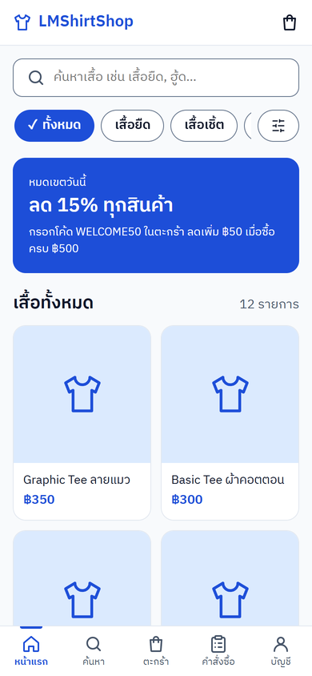
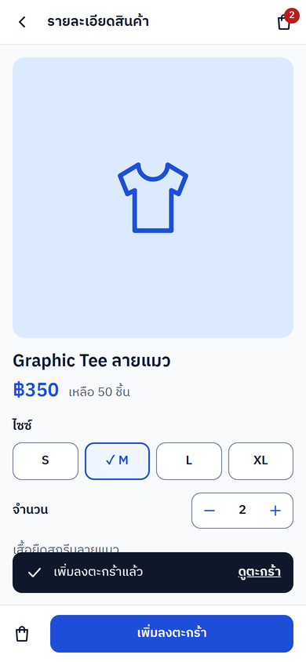
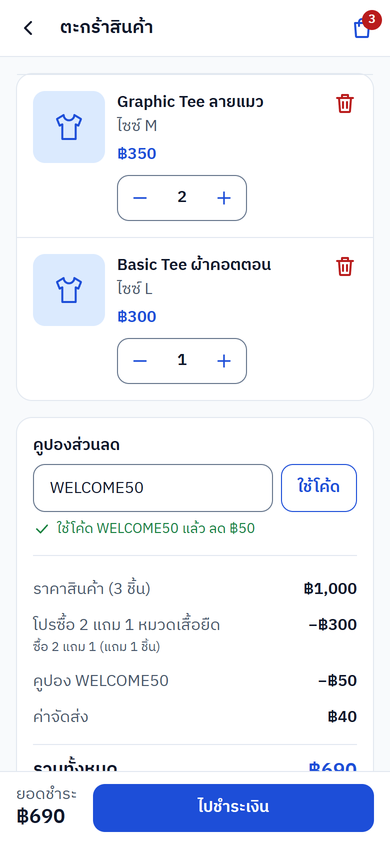
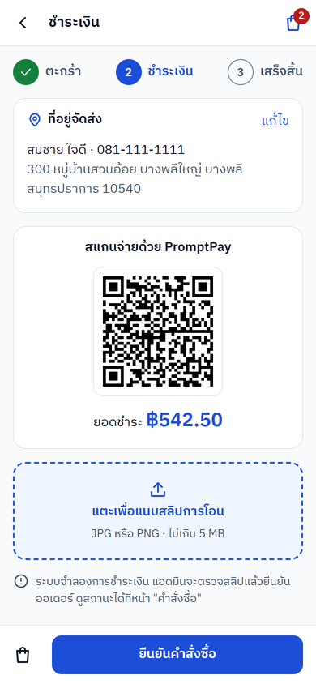
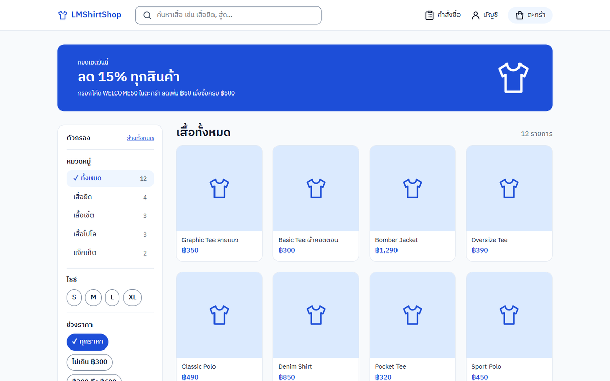
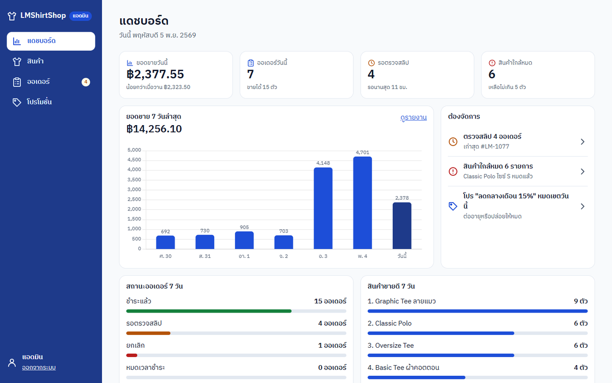
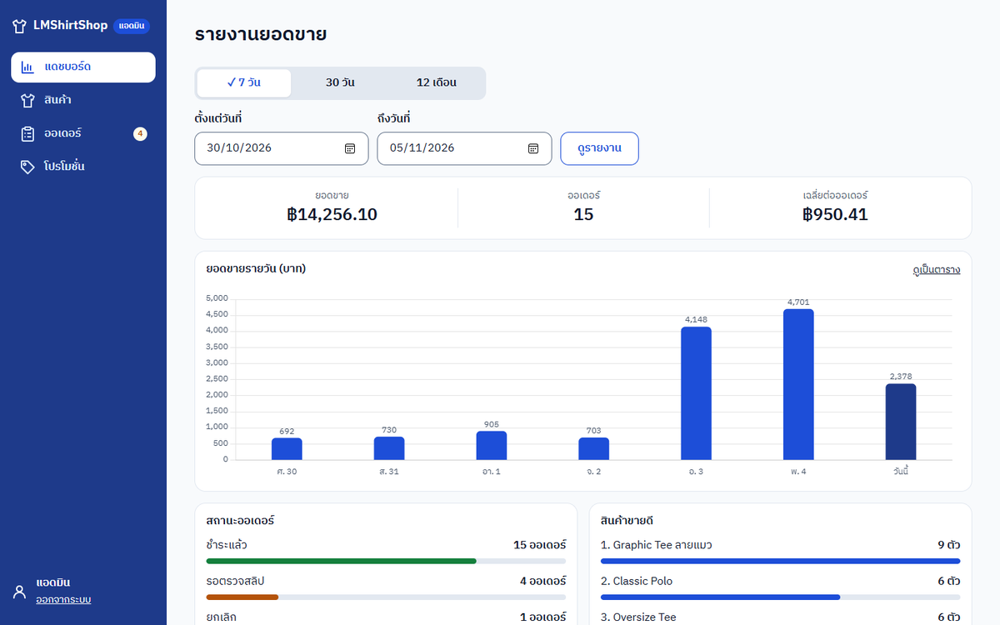

#  LMShirtShop : ร้านขายเสื้อออนไลน์
เป็นฉบับปรับปรุงขึ้น Host 202.44.40.193 โดยปรับ connect ให้เข้ากับ mysql ของ Host และปรับสิทธ์ในการเข้าถึง folder upload ใหม่เป็น 777 เพื่อความสะดวก (RWX)
```
WebDev/
├── project web/                 โค้ดเว็บ
│   ├── upload/                  ปรับสิทธ์ RWX
│      ├── products/             ทำให้ สร้าง/แก้รูป/ลบ
│      ├── slips/                ลงรูปได้
```

> โปรเจกต์รายวิชา 040613411 Web Development

##  ลองเล่นออนไลน์

**https://ninezafire.github.io/WebDev/** → กด "เริ่มลองเล่นเว็บ"
**http://202.44.40.193/~cs6716125/webdev/projectWebdev/** หรือเริ่มลองเล่นเว็บที่นี่

| บทบาท | อีเมล | รหัสผ่าน |
|---|---|---|
| แอดมิน | `admin@shirtshop.test` | `admin123` |
| ลูกค้า | `somchai@test.com` | `password123` |

บัญชีข้างบนเป็นข้อมูลจำลองจากไฟล์ seed ลูกค้าคนอื่นในข้อมูลตัวอย่างใช้รหัส `password123` เหมือนกัน · โค้ดส่วนลดลองใช้ `WELCOME50` `SAVE10` `NEWMONTH100` `LM10`

Docker X : permission denied


##  ภาพหน้าจอ

| หน้าแรก (มือถือ) | หน้าสินค้า | ตะกร้า + คูปอง | ชำระเงิน QR |
|:-:|:-:|:-:|:-:|
|  |  |  |  |

| หน้าแรก (จอใหญ่) | แดชบอร์ดแอดมิน | รายงานยอดขาย |
|:-:|:-:|:-:|
|  |  |  |

##  ฟีเจอร์

**ฝั่งลูกค้า** (`public/`)
- สมัครสมาชิก เข้าสู่ระบบ ("จดจำอีเมล" ด้วย cookie) เปลี่ยนรหัสผ่าน และจัดการที่อยู่จัดส่ง
- ดูสินค้า ค้นหาจากชื่อ รายละเอียด และชื่อหมวด · กรองหมวด ไซซ์ ช่วงราคา และเรียงลำดับ โดยไม่โหลดหน้าใหม่ (Ajax)
- เลือกไซซ์และจำนวน แล้วเพิ่มลงตะกร้าด้วย XMLHttpRequest
- ตะกร้า : ปรับจำนวน ลบ ใส่คูปอง ระบบเลือกโปรโมชั่นที่ลดได้มากที่สุดให้เอง
- ชำระเงินด้วย QR PromptPay (สร้างตามยอดจริง) แล้วแนบรูปสลิป
- ติดตามสถานะคำสั่งซื้อ

**ฝั่งแอดมิน** (`admin/`)
- แดชบอร์ด : ยอดวันนี้ ออเดอร์รอตรวจสลิป สินค้าใกล้หมด โปรใกล้หมดเขต และกราฟ 7 วัน
- ตรวจสลิป ยืนยันการชำระ หรือปฏิเสธพร้อมเหตุผล
- สินค้า : เพิ่ม แก้ไข ลบ อัปโหลดรูป สต็อกแยกไซซ์ ค้นหา กรอง แบ่งหน้า และนำเข้าจากไฟล์ JSON
- หมวดหมู่ : เพิ่ม เปลี่ยนชื่อ ลบ (ลบไม่ได้ถ้ายังมีสินค้าใช้อยู่)
- โปรโมชั่น 4 แบบ (ซื้อ X แถม Y, ลดตามช่วงเวลา, ซื้อมากลดมาก, ชุดแพ็ก) พร้อมตัวอย่างราคา และคูปองส่วนลด
- รายงานยอดขาย : กราฟ ตาราง ปุ่ม 7 วัน / 30 วัน / 12 เดือน และกรอกช่วงวันที่เอง

##  เทคโนโลยี

| ส่วน | ใช้อะไร |
|---|---|
| Frontend | HTML, CSS (Mobile first, Grid, Flexbox), JavaScript (DOM, XMLHttpRequest, Fetch) |
| กราฟ / QR | Chart.js, qrcode-generator (เก็บไว้ใน `assets/vendor` ไม่พึ่ง CDN) |
| Backend | PHP 8.2 + PDO (prepared statement), Session, Cookie |
| Database | MySQL 8 (หรือ MariaDB ใน XAMPP) 13 ตาราง |
| รันระบบ | Docker Compose (web + db + phpMyAdmin) หรือ XAMPP |
| ออกแบบ | Wireframe 21 หน้าจอ, ER Diagram (draw.io), System Architecture |

##  โครงสร้างโปรเจกต์

```
WebDev/
├── project web/                 โค้ดเว็บ (ตัวจริง)
│   ├── public/                  หน้าฝั่งลูกค้า
│   ├── admin/                   หน้าฝั่งแอดมิน
│   ├── api/                     คืนค่าเป็น JSON ให้ Ajax (cart, products, report, promotion_preview)
│   ├── includes/                connect.php (PDO), auth.php (session), pricing.php (โปร/คูปอง), header/footer
│   ├── assets/                  style.css, app.js, ฟอนต์, ไลบรารี
│   ├── index.php                พาไปหน้าแรก public/index.php
│   ├── shirtshop_xampp.sql      โครงสร้าง + ข้อมูลตัวอย่าง
│   ├── docker-compose.yml       web, db, phpmyadmin
│   ├── Dockerfile
│   ├── RUBRIC.md                Rubric แต่ละข้อ → ไฟล์และบรรทัดในโค้ด
│   ├── DEMO.md                  ลำดับการเดโม
│   ├── wireframe.pdf
│   ├── System Architecture — ร้านขายเสื้อออนไลน์.pdf
│   ├── LMshirtER.drawio / LMshirtER.jpg
│   └── Project Rubrics.pdf
├── docs/                        เวอร์ชัน GitHub Pages (PHP WebAssembly + SQLite)
└── README.md
```

13 ตาราง : `users` `addresses` `categories` `products` `product_variants` `product_images` `promotions` `promotion_tiers` `promotion_bundle_items` `coupons` `orders` `order_items` `stock_movements`


ไฟล์ต้นฉบับ [LMshirtER.drawio](project%20web/LMshirtER.drawio) เปิดแก้ด้วย [draw.io](https://app.diagrams.net/)

##  Rubric และเอกสาร

- [RUBRIC.md](project%20web/RUBRIC.md) : Rubric ทั้ง 11 ข้อ (Basic / Bonus / Big Bonus) ดูได้ที่หน้าไหน และโค้ดอยู่ไฟล์ไหนบรรทัดไหน
- [DEMO.md](project%20web/DEMO.md) : ลำดับการเดโมประมาณ 15 นาที
- [wireframe.pdf](project%20web/wireframe.pdf) : Wireframe มือถือ 390px และเดสก์ท็อป 1440px
- [System Architecture](project%20web/System%20Architecture%20%E2%80%94%20%E0%B8%A3%E0%B9%89%E0%B8%B2%E0%B8%99%E0%B8%82%E0%B8%B2%E0%B8%A2%E0%B9%80%E0%B8%AA%E0%B8%B7%E0%B9%89%E0%B8%AD%E0%B8%AD%E0%B8%AD%E0%B8%99%E0%B9%84%E0%B8%A5%E0%B8%99%E0%B9%8C.pdf) : สถาปัตยกรรม 3 ชั้น และการ deploy ด้วย Docker

##  ผู้จัดทำ

| รหัสนักศึกษา | ชื่อ-นามสกุล | หน้าที่ | Rubric | งานหลัก |
|---|---|---|:-:|---|
| 6704062616052 | นันทวัฒน์ ชาติวิชิต | UX/UI Designer & Front-end Lead | 1–5 | Wireframe, System Architecture, ER Diagram, Docker, `style.css` (Selector, Mobile first), Semantic layout, Form validation, เวอร์ชัน GitHub Pages |
| 6704062616079 | พชรพล ฉิมมุสิก | JavaScript & JSON Developer | 6–7 | จัดการ DOM ด้วย JS, QR PromptPay, แดชบอร์ดจาก JSON, ตัวอย่างราคาโปร, นำเข้าสินค้าจากไฟล์ JSON |
| 6704062616125 | ธนโชติ ไชยศิลป์ | Back-end & Database Developer | 8–9 | ฐานข้อมูล + PDO, CRUD สินค้า/หมวดหมู่/โปร, ค้นหาและแบ่งหน้า, Session และ Cookie, ตรวจสลิป, checkout แบบ transaction |
| 6704062616141 | ชนาธิป โกศลจิตร | Ajax & Report Developer | 10–11 | ตะกร้าด้วย XMLHttpRequest / Fetch, ระบบโปรโมชั่นและคูปอง, รายงานยอดขาย (ตาราง, กราฟ, กรองช่วงวันที่) |

## License

จัดทำเพื่อการศึกษาในรายวิชา 040613411 Web Development
ไลบรารีที่ใช้ : [Chart.js](https://www.chartjs.org/) (MIT), qrcode-generator โดย Kazuhiko Arase (MIT), ฟอนต์ IBM Plex Sans Thai (SIL OFL) และในเวอร์ชัน GitHub Pages ใช้ [php-wasm](https://github.com/seanmorris/php-wasm) (Apache-2.0)
รูปภาพประกอบ : [pixa](https://pixabay.com/th/) (CC0),
